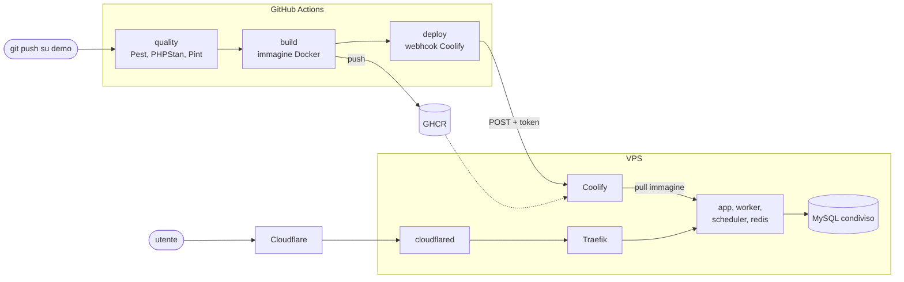

# edisyst-deploy

Maschera del flusso di deploy che uso per le mie applicazioni Laravel: dal push su GitHub all'applicazione online su un VPS gestito con Coolify, esposta tramite Cloudflare Tunnel.

Il caso reale da cui è ricavata è **iron-gym**, un gestionale per palestre il cui codice applicativo non è pubblico. Qui ci sono soltanto i file che riguardano il rilascio, con nomi, domini e valori sostituiti da segnaposto. Non è un progetto da clonare ed eseguire: è la descrizione, con i file veri alla mano, di come porto online un'applicazione.

## Il flusso



Se il grafo non viene visualizzato, [apri la versione immagine](docs/deploy-flow.png).

Un push sul branch `demo` avvia la pipeline GitHub Actions ([`app/.github/workflows/deploy.yml`](app/.github/workflows/deploy.yml)), fatta di tre job in sequenza. `quality` ripete i controlli della CI: test Pest su MySQL e Redis veri, analisi statica con PHPStan, stile del codice con Pint. `build` costruisce l'immagine Docker e la pubblica su GitHub Container Registry. `deploy` chiama il webhook di Coolify. Se un job fallisce i successivi non partono, quindi online finisce solo codice che ha superato tutti i controlli.

In Coolify l'auto-deploy è spento: il rilascio parte solo dalla pipeline. Il server non builda nulla, scarica l'immagine già pronta e ricrea i servizi.

## Sul server

Il VPS ospita Coolify e più applicazioni, ognuna su un proprio sottodominio. Le risorse sono divise in due tipi di progetto Coolify.

Il progetto **infra** è condiviso e contiene solo risorse one-click di Coolify, senza un compose scritto a mano: MySQL, un'unica istanza per tutte le applicazioni con un database e un utente dedicati per ciascuna; phpMyAdmin per l'amministrazione; cloudflared per il tunnel.

Ogni applicazione ha poi il suo progetto, con una risorsa Docker Compose di quattro servizi ([`coolify/compose.yaml`](coolify/compose.yaml)). `app` risponde alle richieste web, `worker` esegue i job in coda, `scheduler` le attività pianificate, `redis` fa da cache, store delle sessioni e backend delle code. I primi tre usano la stessa immagine con un comando diverso. Per raggiungere il MySQL del progetto infra si agganciano alla rete `coolify`, creata da Coolify all'installazione.

Il traffico non arriva direttamente al VPS: i sottodomini puntano al tunnel Cloudflare, cloudflared inoltra le richieste al proxy di Coolify (Traefik) e da lì al container. L'IP del server non compare nei record DNS.

## Struttura del repository

```
edisyst-deploy/
├── app/                          # file che vivono nel repository dell'applicazione
│   ├── .github/workflows/
│   │   └── deploy.yml            # pipeline quality -> build -> deploy
│   ├── docker/production/
│   │   ├── Dockerfile            # multi-stage: asset Vite, dipendenze Composer, runtime FrankenPHP
│   │   ├── entrypoint.sh         # attesa del DB, migration, cache di Laravel
│   │   └── opcache.ini
│   ├── .dockerignore
│   └── .gitattributes
└── coolify/                      # configurazione lato Coolify
    ├── compose.yaml              # risorsa Docker Compose dell'applicazione
    └── .env.example              # variabili da impostare in Coolify
```

Il workflow sta in `app/.github/workflows/` e non nella root proprio perché GitHub esegue solo i workflow della root: qui resta un file da leggere.

## Scelte

**L'immagine si costruisce in CI.** Asset front-end e dipendenze Composer si buildano sui runner GitHub, con la cache di BuildKit; il VPS si limita a scaricare l'immagine. A ogni build viene riscaricata anche l'immagine base (`pull: true`), così gli aggiornamenti di PHP e Debian entrano senza interventi manuali.

**Un'immagine, tre ruoli.** app, worker e scheduler partono dalla stessa immagine. Le migration le esegue solo `app` (`RUN_MIGRATIONS=true`); worker e scheduler aspettano che `app` risulti healthy, così non lavorano mai su uno schema a metà.

**Cache di Laravel all'avvio, non in build.** Le variabili d'ambiente arrivano da Coolify solo quando il container parte, quindi `config:cache`, `route:cache`, `view:cache` ed `event:cache` girano nell'entrypoint. Prima l'entrypoint aspetta che MySQL risponda e a ogni tentativo fallito stampa l'ultima riga dell'errore: un "connection refused" durante l'avvio si distingue subito da una password sbagliata.

**Healthcheck senza curl.** Il controllo su `/up` usa PHP, che nell'immagine c'è sempre.

**Laravel dietro il tunnel.** Tra il client e l'applicazione ci sono cloudflared e Traefik, quindi Laravel deve fidarsi degli header `X-Forwarded-*`, ma solo quando arrivano da indirizzi di reti private. In `bootstrap/app.php`:

```php
->withMiddleware(function (Middleware $middleware): void {
    // Cloudflare Tunnel -> Traefik: fidati solo degli hop su reti private,
    // così isSecure() vede https e ip() restituisce l'IP reale del client
    $middleware->trustProxies(at: [
        '127.0.0.1',
        '10.0.0.0/8',
        '172.16.0.0/12',
        '192.168.0.0/16',
    ]);
})
```

**È una demo.** L'ambiente serve a mostrare l'applicazione ad altri sviluppatori: nell'immagine ci sono anche le dipendenze dev (i seeder usano Faker), le mail finiscono nel log e Redis non persiste su disco.

## Segreti

Nel repository non c'è nessun valore reale. I segreti della pipeline sono GitHub Actions secrets: `COOLIFY_WEBHOOK_URL` e `COOLIFY_TOKEN` per il deploy, mentre il push su GHCR usa il `GITHUB_TOKEN` del workflow. Quelli dell'applicazione, come `APP_KEY` e la password del database, sono variabili della risorsa in Coolify ([`coolify/.env.example`](coolify/.env.example)). Nel compose sono scritti come `${VAR:?}`: se una variabile manca, il deploy si ferma invece di avviare un container con un valore vuoto.

## Una nuova applicazione

1. Copiare i file di `app/` nel repository dell'applicazione e adattare nomi ed estensioni PHP.
2. Creare database e utente dedicati sul MySQL del progetto infra.
3. Creare il progetto Coolify con la risorsa Docker Compose, impostare le variabili e, con l'immagine privata, autenticare il server su GHCR.
4. Aggiungere il sottodominio al tunnel Cloudflare.
5. Creare in Coolify il token API e copiare token e deploy webhook nei secrets del repository.
6. Spegnere l'auto-deploy della risorsa e fare push sul branch `demo`.
